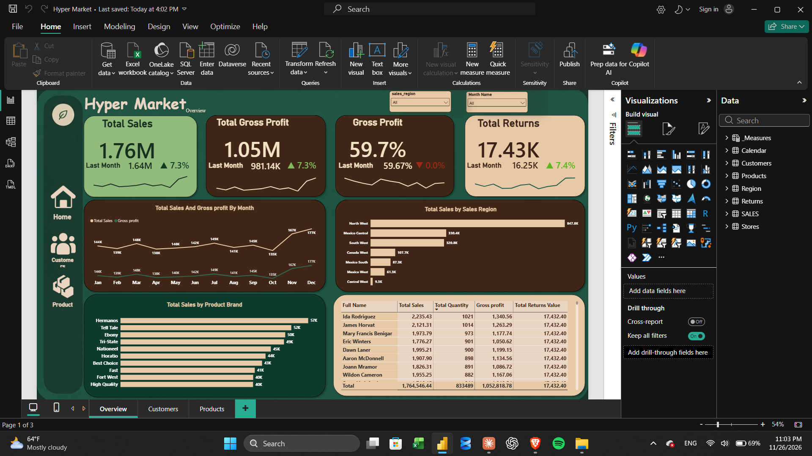
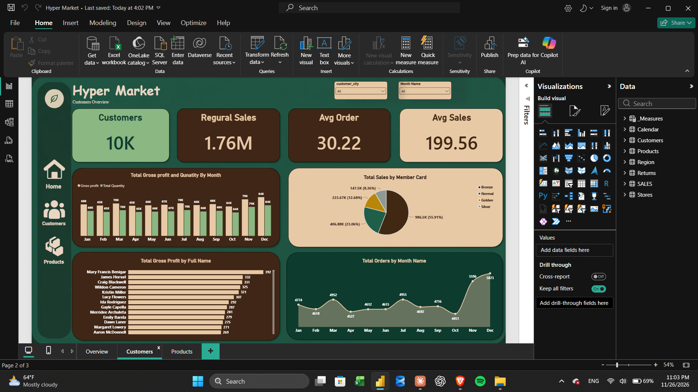
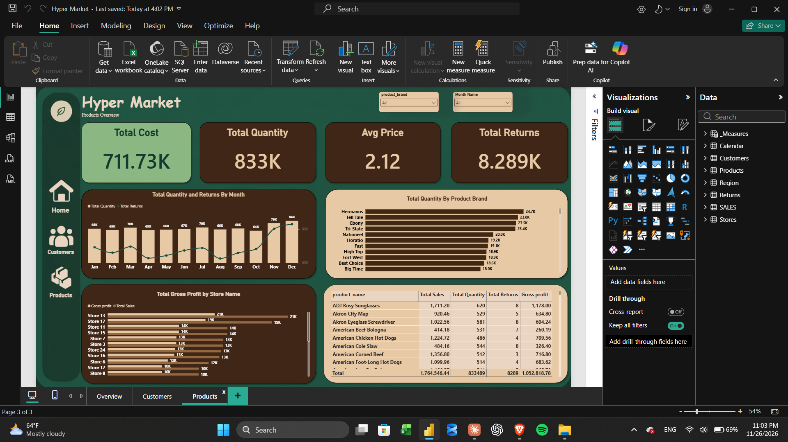

# 🛒 Hypermarket Sales Analysis | Power BI Dashboard

An interactive, 3-page Power BI dashboard that analyzes the sales performance of a hypermarket chain across **regions, customers, and products**. It helps management track revenue, profitability, and returns, and see which brands, stores, and customer segments drive the business.

---

## 🎯 Business Questions

- How are Total Sales, Gross Profit, and Returns performing compared to last month?
- Which regions, product brands, and stores generate the most sales and profit?
- Who are the top customers, and how do membership card tiers (Bronze, Normal, Golden, Silver) contribute to sales?
- How do order volume, quantity sold, and returns change month by month?

---

## 📊 Dashboard Pages

### 1. Overview

- **KPI cards:** Total Sales (1.76M), Total Gross Profit (1.05M), Gross Profit Margin (59.7%), and Total Returns Value (17.43K), each compared with last month.
- **Total Sales and Gross Profit by Month:** a line chart showing the monthly trend.
- **Total Sales by Sales Region:** a regional comparison.
- **Total Sales by Product Brand** and a detailed table by customer.
- **Slicers:** Sales Region and Month.

### 2. Customers

- **KPI cards:** Customers (10K), Regular Sales (1.76M), Average Order (30.22), and Average Sales (199.56).
- **Gross Profit and Quantity by Month**, **Total Sales by Member Card** (pie chart), **Top Customers by Gross Profit**, and **Total Orders by Month**.
- **Slicers:** Customer City and Month.

### 3. Products

- **KPI cards:** Total Cost (711.73K), Total Quantity (833K), Average Price (2.12), and Total Returns in units (8.289K).
- **Quantity and Returns by Month**, **Quantity by Product Brand**, **Gross Profit and Sales by Store**, and a detailed product table.
- **Slicers:** Product Brand and Month.

---

## 🔑 Key Insights

- The business runs at a high **gross profit margin of about 59.7%**.
- The **North West region** is the largest market, contributing nearly half of total sales (847.8K out of 1.76M).
- **Hermanos** is the top-selling brand by both sales and quantity.
- Order volume peaks at the end of the year, reaching about 5.9K orders in December.
- **Bronze** card members generate about **56% of total sales** (986.5K), followed by Normal (23%), Golden (13%), and Silver (8%).
- Returns are limited: about 17.4K in returned value and 8.3K returned units out of 833K units sold.

---

## 🧮 Data Model

A relational model built around two fact tables and five dimension tables:

| Type | Tables |
|------|--------|
| Fact | `SALES`, `Returns` |
| Dimension | `Calendar`, `Customers`, `Products`, `Region`, `Stores` |
| Measures | `_Measures` (a dedicated table for DAX measures) |

---

## 🛠️ Tools & Skills

- **Power BI Desktop**
- **DAX** (KPIs, gross profit, profit margin, month-over-month comparison)
- **Data Modeling** (relationships between fact and dimension tables)
- **Dashboard Design** (custom color theme, navigation buttons, slicers, multi-page layout)

---

## 📂 Files in this folder

| File | Description |
|------|-------------|
| `Hyper_Market.pbix` | The Power BI report (open with Power BI Desktop) |
| `Overview.png`, `Customers.png`, `Products.png` | Dashboard page screenshots |

---

## 👤 Author

**Ahmed Sherif** – Aspiring Data Analyst
🔗 [LinkedIn](https://www.linkedin.com/in/ahmed-sherif-2465382a6) | 💻 [GitHub](https://github.com/a7medsherif)
