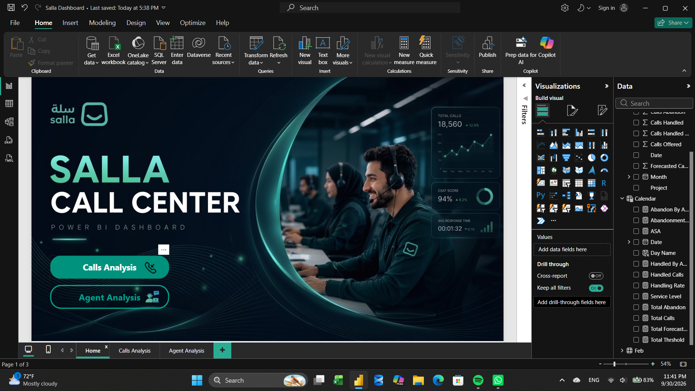
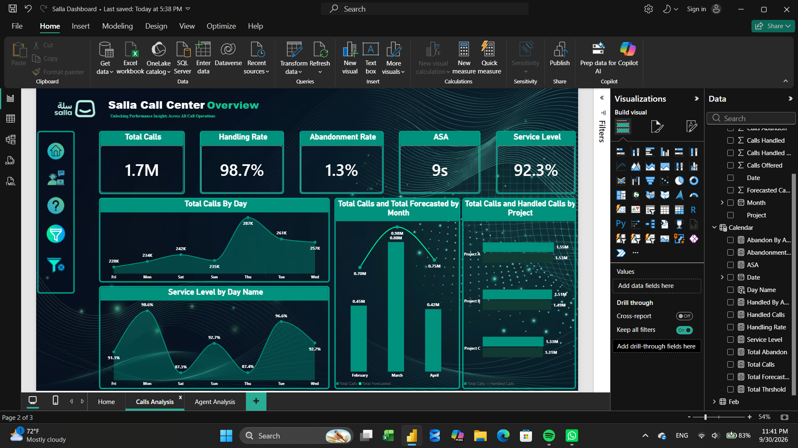
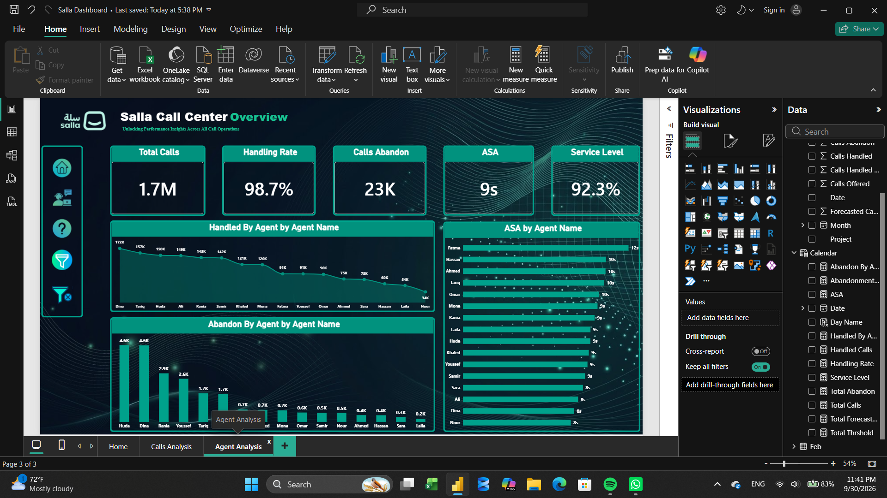
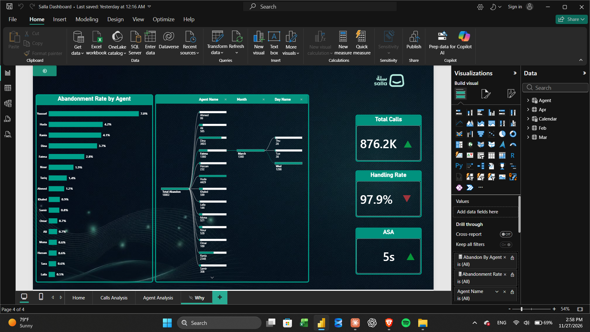

# 🎧 Salla Call Center Dashboard | Power BI

A 4-page Power BI dashboard that monitors the performance of the Salla call center: call volumes, service quality, and agent-level results, plus a deep-dive page that explains where call abandonment comes from.

---

## 🎯 Business Questions

- How many calls does the center receive, and how many are handled or abandoned?
- Is the center meeting its service targets (Handling Rate, ASA, Service Level)?
- Which days and months are the busiest, and how do actual calls compare with forecasted calls?
- How does each agent perform in handled calls, answer speed, and abandoned calls?
- Which agents, months, and days drive call abandonment?

---

## 📊 Dashboard Pages

### 1. Home

A landing page with navigation buttons to the **Calls Analysis** and **Agent Analysis** pages.

### 2. Calls Analysis

- **KPI cards:** Total Calls (1.7M), Handling Rate (98.7%), Abandonment Rate (1.3%), ASA (9s), and Service Level (92.3%).
- **Total Calls by Day** and **Service Level by Day Name**.
- **Total Calls vs. Total Forecasted by Month** and **Total Calls vs. Handled Calls by Project**.
- **Slicers:** Month and Project.

### 3. Agent Analysis

- **KPI cards:** Total Calls (1.7M), Handling Rate (98.7%), Calls Abandon (23K), ASA (9s), and Service Level (92.3%).
- **Handled Calls by Agent**, **ASA by Agent**, and **Abandoned Calls by Agent**.
- **Slicers:** Agent Name and Month.

### 4. Why (Abandonment Deep-Dive)

A hidden page reached from a button on the Calls Analysis page. It shows the **Abandonment Rate by Agent** and a **Decomposition Tree** that breaks Total Abandon down by Agent, Month, and Day.

---

## 📖 KPI Definitions

| KPI | Meaning |
|-----|---------|
| Total Calls | Total number of calls received |
| Handling Rate | Share of calls that were handled by an agent |
| Abandonment Rate | Share of calls abandoned before being answered |
| ASA | Average Speed of Answer: the average time a caller waits for an agent |
| Service Level | Share of calls answered within the target time |

---

## 🔑 Key Insights

- The center handles **98.7%** of calls, with a **1.3%** abandonment rate, a 9-second ASA, and a **92.3%** service level.
- **Thursday** is the busiest day (287K calls) and **Friday** the quietest (228K).
- Service Level is best on **Monday (98.6%)** and weakest on **Saturday (87.3%)** and **Thursday (87.4%)**. The busiest day is also among the weakest, which points to a staffing opportunity.
- **Dina** handled the most calls (172K) and **Nour** the fewest (34K).
- **Fatma** has the longest ASA (12s).
- **Youssef** has the highest abandonment rate (7.0%), followed by Huda (4.2%) and Rania (4.1%).

---

## 🧮 Data Model

| Table | Purpose |
|-------|---------|
| `Feb`, `Mar`, `Apr` | Monthly call data (calls offered, handled, abandoned, forecasted calls, and project) |
| `Agent` | Agent details used for agent-level analysis |
| `Calendar` | Date table used for day and month analysis |

---

## 🛠️ Tools & Skills

- **Power BI Desktop**
- **DAX** (Handling Rate, Abandonment Rate, ASA, Service Level, forecasted vs. actual calls)
- **Data Modeling** (relationships between call data, agents, and calendar)
- **Dashboard Design** (custom dark-teal theme, navigation buttons, slicers, and a hidden drill-down page with a Decomposition Tree)
- **Call Center KPIs**

---

## 📂 Files in this folder

| File | Description |
|------|-------------|
| `Salla_Dashboard.pbix` | The Power BI report (open with Power BI Desktop) |
| `Home.png`, `Calls_Analysis.png`, `Agent_Analysis.png`, `Why.png` | Dashboard page screenshots |

---

## 👤 Author

**Ahmed Sherif** – Aspiring Data Analyst
🔗 [LinkedIn](https://www.linkedin.com/in/ahmed-sherif-2465382a6) | 💻 [GitHub](https://github.com/a7medsherif)
